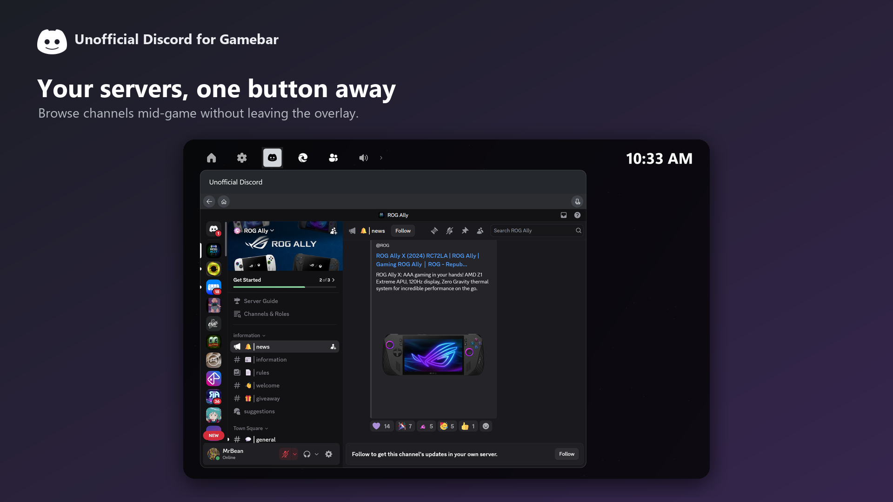
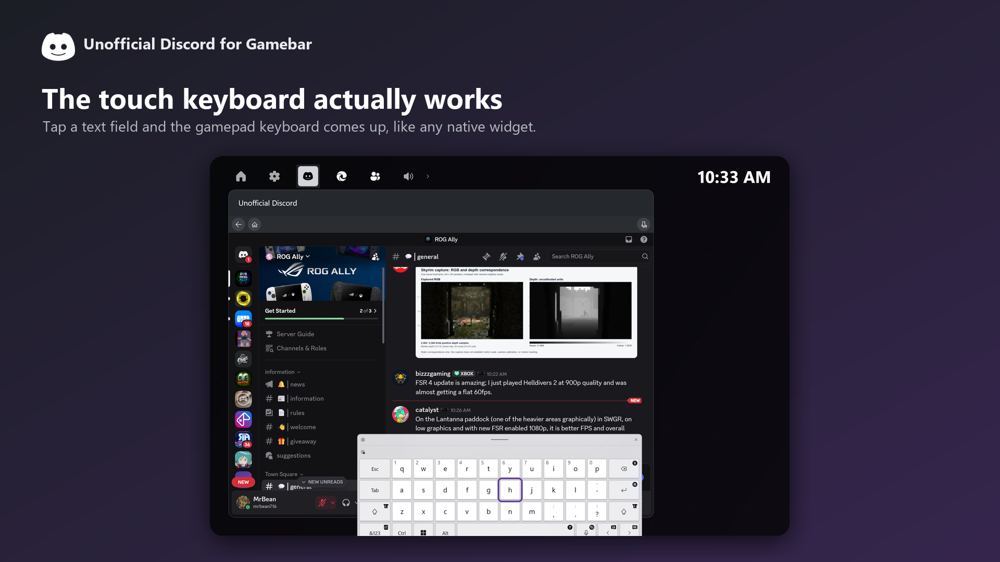
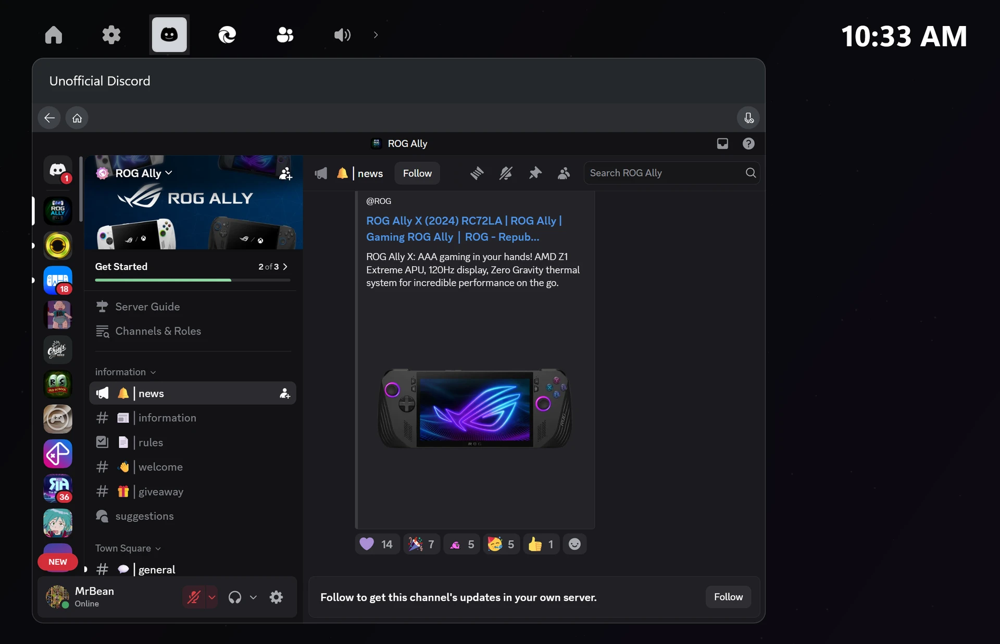

<p align="center">
  
</p>

# Unofficial Discord for Gamebar

Discord's web app as an **Xbox Game Bar widget**, built for Windows handhelds like the ROG Xbox Ally X.
Press the Xbox button, tap Discord, chat, join voice, close Game Bar and keep playing: the call keeps
running.

> **Unofficial.** This project is not affiliated with, endorsed by or sponsored by Discord Inc. It embeds
> the official web app at discord.com inside a Microsoft Edge WebView2 control, exactly as a browser
> would. It ships no Discord code, never uses the Discord API and never touches your token.

Website: **Coming Soon!** · Download: [Releases](../../releases) ·
Privacy: [PRIVACY.md](PRIVACY.md) · License: [MIT](LICENSE)

## Screenshots








## What you get

- **Discord, full screen, inside Game Bar.** The widget asks Game Bar for the largest window it will grant
  and centers it. The desktop layout is used on purpose (Discord blocks voice on mobile browsers).
- **Voice keeps running with Game Bar closed.** Join a call, close Game Bar, keep playing; you still hear
  and are heard.
- **Mic button** on a slim strip above the page: one tap mutes or unmutes you. It reads Discord's own mute
  state first, so it never gets out of sync with Discord's controls.
- **Back and Home buttons** on the same strip, so a Discord help page or a link never traps you. Links
  to anything outside Discord open in your real browser.
- **Touch keyboard.** Tap a text field and the on-screen keyboard comes up, inside Game Bar.
- **Light when you're not using it.** Hidden and not in a call, the page is suspended after 10 seconds,
  unloaded after 45 seconds and the browser engine is shut down after 4 minutes. Opening Game Bar
  pre-warms it, so the tap that follows is fast.
- **No pop-ups over games.** Desktop notifications are denied for the page.

## Requirements

- Windows 11 with Xbox Game Bar (the handheld compact UI or the desktop one).
- Microsoft Edge WebView2 Runtime (already present on Windows 11).
- A Discord account. Everything else is Discord's own web app.
- Tested on the ROG Xbox Ally X. Any Game Bar device should work.

## Install

**From a release (today):** download `UnofficialDiscordForGamebar-Setup.exe` from
[Releases](../../releases) and run it. It installs the package and, for this beta, the self-signed
certificate it is signed with a plan release for the Microsoft store (free just need to get it approved) 
Upgrades: run the newer installer over the old one.

Then press the **Xbox button** (or `Win+G`), open the widget menu, and pick **Unofficial Discord**.
Pin it sits in the home bar. Sign in with the QR code or your credentials.
Close the desktop Discord app if you have it, so Discord isn't running twice.

## About the microphone badge

While you're in a call with Game Bar closed, Game Bar shows a small microphone badge on screen. People
ask for it to be hidden. It can't be, and here's why.

Windows mutes the audio of a UWP app that isn't in the foreground. Game Bar's way to let a hidden
widget keep capturing and playing audio is an `XboxGameBarWidgetActivity` created with Game Bar's
**microphone activity id**. That id is what tells Windows "this widget may keep using audio while
hidden", and the badge is Game Bar's indicator for exactly that permission. A plain activity keeps the
process alive but the call goes silent. So the badge and the working call are the same thing.

Things to know:

- **Don't tap the badge.** Tapping it ends the activity and Windows mutes the call. Drag it to a corner
  instead. If it does get tapped, the widget notices Windows muting it and asks Game Bar for the
  activity again; open Game Bar once if it doesn't come back on its own.
- It appears when you join voice and disappears when you leave.
- The widget keeps the microphone capture open for the whole call, muted or not, because a background
  app is not allowed to reopen the microphone later. Muting still mutes; Discord just sees a silenced
  track instead of a closed one.

## How it stays light

Measured on the ROG Xbox Ally X. Numbers are the whole widget including its WebView2 processes.

| State | What runs | Memory (approx.) |
|---|---|---|
| Open, chatting | Discord's page, one renderer process | ~780 MB |
| Hidden, in a call | Page kept active for audio, low-memory mode | ~400 MB |
| Hidden, idle 10 s | Page suspended by WebView2 | drops with time |
| Hidden, idle 45 s | Page unloaded (about:blank) | ~200 MB |
| Hidden, idle 4 min | Browser engine closed | ~90 MB |

Other choices that matter: one renderer process and one process per site (`--renderer-process-limit=1`),
no SmartScreen lookups, no background networking or component updates from the engine, reduced-motion
signalled to the page so Discord drops its animations, video elements paused while hidden, memory-usage
target set to low whenever the widget is pinned over a game or hidden in a call.

## Other things worth knowing

- **Touch keyboard.** WebView2 can't summon the keyboard inside Game Bar. The widget watches the page for
  a focused text field, moves focus to an invisible text box of its own (which Game Bar does give a
  keyboard), and relays what you type back into the page, suggestions included.
- **Full screen.** The widget requests the whole screen and steps down (94 %, 88 % …) until Game Bar
  accepts a size, then centers.
- **Where you can browse.** Only discord.com (and its ptb/canary/discordapp/discord.gg hosts) load inside
  the widget; everything else opens in your default browser. A Discord page that isn't the app (terms,
  help, blog) shows a "Back to Discord" button.
- **Desktop user agent.** On purpose. Discord's phone layout would fit a 7" screen better, but Discord
  refuses voice on mobile browsers ("Unsupported Browser").
- **Standalone window.** The app also runs from the Start menu as a plain window, useful for signing in
  with a mouse and keyboard. The low-power path only exists inside Game Bar.
- **Upgrading while in a call.** Install the new version after leaving voice. If the mic badge refuses to
  come back after an upgrade, terminate Game Bar once (Settings, Apps, Xbox Game Bar, Advanced options,
  Terminate) or reboot; Game Bar holds the old activity until then.
- **No controller push-to-talk.** Versions before 1.1.0.0 had one; it was removed because its key
  helper's system-wide keyboard hook cost performance on handhelds. Mute with the widget's Mic button or
  Discord's own controls.

## Troubleshooting

| Symptom | Cause and fix |
|---|---|
| Mic badge vanished and the call went silent | The badge was tapped. Open Game Bar, the widget re-requests the activity. |
| "Unsupported Browser" when joining voice | Something changed the user agent; file an issue with your version. |
| Keyboard doesn't appear | Tap the field once more. If it never appears, reinstall: the Game Bar proxy/stub registration in the package manifest is what makes keyboards work. |
| Widget shows a blank page after being idle | Normal: it was unloaded to save memory and is reloading. 2–3 s. |

## Logs and bug reports

The widget keeps a small rolling log of its own state changes (no message content):
`%LOCALAPPDATA%\Packages\DiscordBar.Widget_*\LocalState\power.log`. Paste the path into File Explorer.
Attach the last 100 lines or so to a [bug report](../../issues/new/choose).

## Building from source

Requirements: Visual Studio 2022 with the Universal Windows Platform workload and the Windows 11 SDK
(10.0.22621).

```bash
msbuild DiscordBar.sln /p:Configuration=Release /p:Platform=x64 /p:UapAppxPackageBuildMode=SideloadOnly /p:AppxPackageDir=AppPackages\
powershell -ExecutionPolicy Bypass -File installer\build-installer.ps1
```

The sideload package is signed
with `DiscordBar\DiscordBar_TemporaryKey.pfx` (not in the repo; create your own test certificate in VS or
with `New-SelfSignedCertificate`, publisher `CN=DiscordBarDev`). CI builds an unsigned package on every
push as a check.


## Credits

Designed, directed and tested on the Ally by Codex64, built together with Claude Code. Built on Microsoft's Xbox Game Bar SDK, WinUI 2 and WebView2.
"Discord" is a trademark of Discord Inc.; this project is independent of it.

## License

MIT, see [LICENSE](LICENSE).
